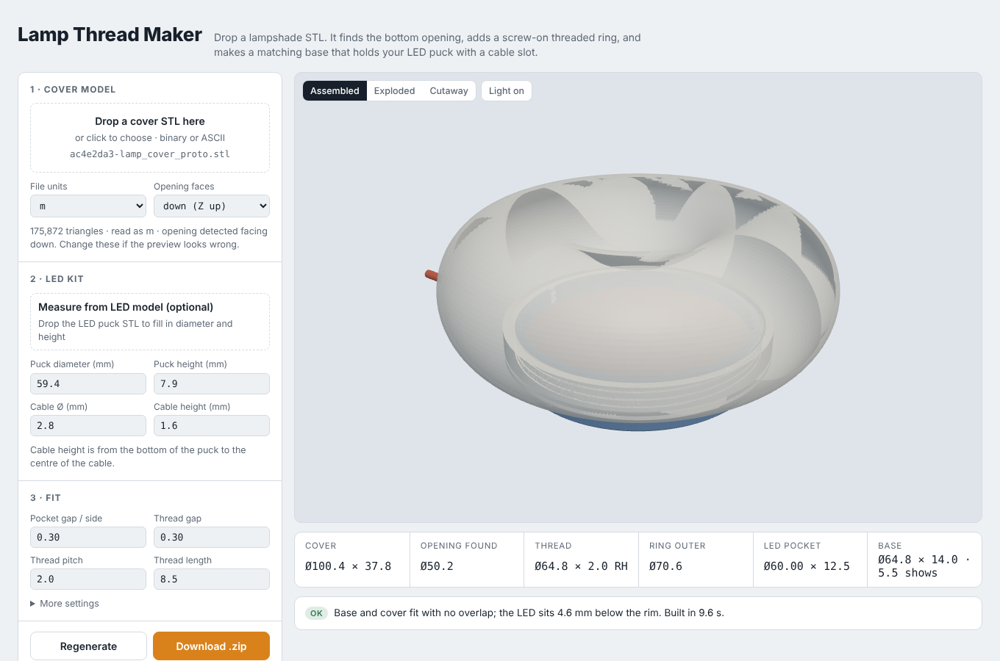

# Lamp Thread Maker

Drop a lampshade STL into the page. It finds the bottom opening, adds a screw-on threaded ring to the shade, and generates a matching base that holds an LED puck light with a cable slot. Everything runs in the browser; no files are uploaded anywhere.



## Use it

Open `index.html` in a browser (or enable GitHub Pages for this repo), then:

1. **Drop your cover STL.** Units (mm / cm / m / inch) and which way the opening faces are detected automatically. Override them if the preview looks wrong.
2. **Set the LED kit.** Enter the puck diameter and height, or drop the LED's STL to measure them. Enter the cable diameter and its height above the puck bottom.
3. **Adjust the fit** if needed, then **Download .zip** to get the threaded cover, the base, and a settings note.

Print both parts upright as exported, with the flat side on the plate.

## How it works

- **Opening detection:** the model is tried in all six orientations. A real lamp opening leads up into a hollow that widens, while a dimple narrows and closes. The tool slices up from the bottom and picks the orientation with the widest connected cavity.
- **Threads:** a 2D cross-section with radius `r(θ) = root + profile((−pitch·θ/2π) mod pitch)` is extruded with a twist of 360° per pitch, giving a true right-hand helix. The cover's female thread is the same solid with every radius increased by the thread gap, subtracted from a ring, so the two always mate.
- **Cover:** everything inside the ring's radius is cut away for the length of the thread, and the threaded ring is merged into the shell. If the opening is wider than the ring, a flat flange bridges the gap.
- **Base:** a short band below the cover, a threaded neck, an LED pocket, a full-height cable slot (so the LED drops in with its cable attached), and a push-out hole underneath.
- **Checks:** base ∩ cover volume must be zero; it also warns if the ring doesn't join the shell or would stick out past a narrow cover.

Geometry uses [manifold-3d](https://github.com/elalish/manifold) (WebAssembly, inlined into the page); the preview uses [three.js](https://threejs.org).

## Default fit

| Setting | Default |
|---|---|
| LED pocket gap | 0.30 mm per side |
| Thread gap | 0.30 mm radial |
| Thread | 2.0 mm pitch, 0.9 mm deep, ~52° flanks, right-hand |
| Thread length | 8.5 mm (≈4 turns) |
| Base wall / floor | 1.5 mm / 1.5 mm |
| Visible base band | 5.5 mm |

These were tuned on a Bambu Lab A1 in PLA. If the thread binds, raise the thread gap in 0.05 mm steps.

## Limits

- The shade should be roughly round around a vertical axis. The ring is centred on the model's bounding box.
- The model must be a closed solid. Run "Fix model" in your slicer first if it isn't.
- Large models (~175k triangles) take about 10 s to process.

## Develop

```
npm install
npm run build      # writes index.html from src/
```

- `src/lampcore.js`: geometry engine (STL parsing, orientation, threads, base, STL and ZIP export).
- `src/app.html`: UI and 3D preview.
- `reference/build_lamp_v3.py`: the original Python (trimesh + manifold3d) script the tool was ported from.
